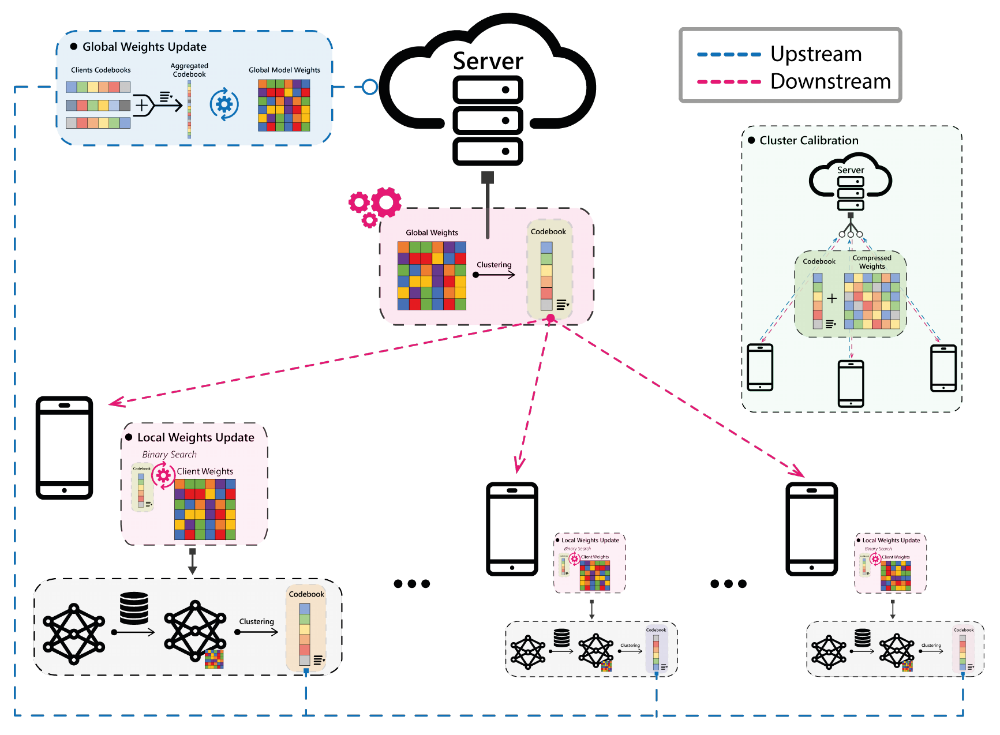

# FedCode

**FedCode: Communication-Efficient Federated Learning via Transferring Codebooks**

Saeed Khalilian, Vasileios Tsouvalas, Tanir Ozcelebi, Nirvana Meratnia<br>
IEEE EDGE 2024

[ Paper](https://ieeexplore.ieee.org/document/10646450/) · [ Project](https://nousphera.github.io/projects/fedcode/) · [ Poster](https://nousphera.github.io/assets/posters/fedcode-a0-landscape.pdf) · [Citation](#citation)

## Abstract

FedCode reduces federated communication by exchanging codebooks of weight-cluster centers. Clients and the server use these centers to update their existing weight arrangements, with periodic calibration rounds transmitting cluster assignments as well. Independent uplink and downlink schedules control calibration frequency, allowing experiments to study the communication–accuracy tradeoff with vision and audio models.

<p align="center">
  
</p>

*Most FedCode rounds communicate cluster centers upstream and downstream. Periodic transfers of compressed weights recalibrate the client and server models. [Figure 2 in the public preprint](https://arxiv.org/pdf/2311.09270).*

## Installation

Use Python 3.11 and a dedicated virtual environment.

```bash
mkdir -p "$HOME/research-code" "$HOME/.venvs"
cd "$HOME/research-code"
git clone https://github.com/Nousphera/FedCode.git
cd FedCode
python3.11 -m venv "$HOME/.venvs/fedcode"
source "$HOME/.venvs/fedcode/bin/activate"
python -m pip install -r requirements.txt
python -m pip check
```

## Data

```bash
python scripts/prepare_data.py --dataset cifar10 --root datasets --download
python scripts/prepare_data.py --dataset cifar10 --root datasets --validate
```

Use `cifar100` for CIFAR-100 or `spcm` for Speech Commands v2. The
[dataset guide](docs/DATA_SETUP.md) describes NPZ imports, audio validation, and
the twelve-class label mapping. Prepared files feed the training loader directly.

## Training

Run three rounds on generated images to exercise codebook and calibration modes:

```bash
python train.py --dataset synthetic --clients 2 --rounds 3 --epochs 1 \
  --batch-size 8 --clusters 4 --start-round 1 --broadcast-rate 3 \
  --request-rate 2 --output runs/smoke
```

Train ResNet-20 on prepared CIFAR-10:

```bash
python train.py --dataset cifar10 --data-root datasets --model resnet20 \
  --clients 10 --rounds 60 --epochs 4 --batch-size 128 --lr .001 \
  --clusters 64 --split noniid --alpha 10 --participation 1 --start-round 2 \
  --broadcast-rate 5 --request-rate 2 --seed 42 --output runs/cifar10-resnet
```

The runner trains clients sequentially and uses stock Flower protobufs for
communication accounting. Client weights persist by identity between codebook
and calibration rounds. Use `--model mobilenet` for MobileNet, or
`--dataset spcm --model yamnet` for audio. `python train.py --help` lists options.

## Evaluation

The runner evaluates the global model on the test split after every round and
records accuracy as a fraction in `rounds[].accuracy`, alongside loss and
upstream/downstream protobuf byte counts.

```bash
python -m json.tool runs/cifar10-resnet/results.json
```

For the CIFAR-100 configuration used in the table below, change the training
command to `--dataset cifar100 --rounds 100` and choose a new output directory.
[Method settings](docs/METHODS.md) describe the calibration intervals and
communication accounting.

## Configuration and outputs

`--broadcast-rate` controls downlink calibration and `--request-rate` controls
uplink calibration. `--split noniid --alpha 10` selects a Dirichlet partition
with concentration 10; use `--alpha .1` for stronger class heterogeneity.
[Method settings](docs/METHODS.md) explain payloads, cold-start clients,
partitioning, and the calibration schedule.

Every run uses a new output directory. `results.json` records configuration,
serialized request/response byte counts, and each round's communication mode.
`model-state.pt` and `final-parameters.npz` store final weights;
`training.log` records execution. Temporary client caches are removed after the
run; `--init-state` initializes a new run from a weights-only state dictionary.
The [testing guide](docs/TESTING.md) covers codec, training, and data checks.

## Results

Reported CIFAR-100 / ResNet-20 results from [Table 6 of the paper’s public preprint](https://arxiv.org/pdf/2311.09270v1#page=9): ten clients, full participation, 100 rounds, four local epochs, 64 centers, and calibration rates F1 = 0.2 / F2 = 0.5. Data transmission reduction (DTR) is relative to FedAvg.

| Method | Accuracy (%) | Downstream DTR (×) | Upstream DTR (×) | Joint DTR (×) |
| --- | --- | --- | --- | --- |
| FedAvg | 61.22 | — | — | — |
| FedAvg + weight clustering | 58.78 | 5.3 | 5.3 | 5.3 |
| FedZip | 57.98 | — | 19.8 | 1.9 |
| FedCode | 58.07 | 24.2 | 10.4 | 14.6 |

FedCode reaches 14.6× joint communication reduction at 58.07% accuracy. Dashes retain entries unreported in the source table.

## Citation

If you use this work, please cite:

```bibtex
@inproceedings{khalilian2024fedcode,
  title = {{FedCode}: Communication-Efficient Federated Learning via Transferring Codebooks},
  author = {Khalilian, Saeed and Tsouvalas, Vasileios and Ozcelebi, Tanir and Meratnia, Nirvana},
  booktitle = {2024 IEEE International Conference on Edge Computing and Communications (EDGE)},
  year = {2024},
  pages = {99--109},
  publisher = {IEEE},
  doi = {10.1109/EDGE62653.2024.00022},
  url = {https://doi.org/10.1109/EDGE62653.2024.00022}
}
```

Machine-readable metadata: [CITATION.cff](CITATION.cff) · [BibTeX](citation.bib).

## License

[MIT](LICENSE), with model-specific MIT/BSD notices in [NOTICE](NOTICE) and `licenses/`. See [attribution](PROVENANCE.md).
