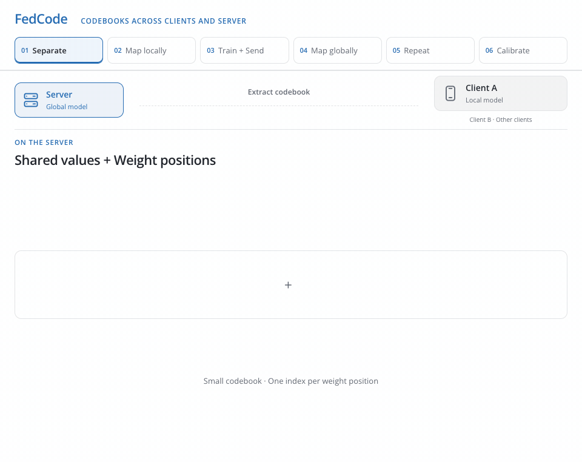

<h1 align="center">FedCode</h1>
<p align="center"><strong>Communication-Efficient Federated Learning via Transferring Codebooks</strong></p>
<p align="center">Saeed Khalilian · <a href="https://vtsouval.github.io/"><strong>Vasileios Tsouvalas</strong></a> · Tanir Özçelebi · Nirvana Meratnia</p>

<p align="center">
  <a href="https://doi.org/10.1109/EDGE62653.2024.00022" title="Read the paper"></a>
  <picture></picture>
  <a href="https://nousphera.github.io/FedCode/" title="Explore the project"></a>
  <picture></picture>
  <a href="https://nousphera.github.io/assets/posters/fedcode-a0-landscape.pdf" title="View the poster"></a>
</p>

## Abstract

**FedCode** reduces communication in *federated learning* by exchanging **compact codebooks**. Clients cluster their model weights and transmit the resulting *cluster centers*; the server combines these codebooks to update the global model. **Periodic calibration** exchanges *bit-packed weight assignments* to realign the client and server models. This separates frequent codebook exchange from less frequent full reconstruction, reducing transmitted data while retaining competitive accuracy. Experiments span **CIFAR-10, CIFAR-100 and Speech Commands**, using *ResNet20, MobileNetV2 and YAMNet*.

<p align="center">
  <a href="docs/assets/readme/method-light.mp4" title="Watch the method video">
    <picture>
      <source media="(max-width: 600px) and (prefers-color-scheme: dark)" srcset="docs/assets/readme/method-dark-mobile.gif">
      <source media="(max-width: 600px)" srcset="docs/assets/readme/method-light-mobile.gif">
      <source media="(prefers-color-scheme: dark)" srcset="docs/assets/readme/method-dark.gif">
      
    </picture>
  </a>
</p>

## Setup

Create and activate the `fedcode` environment:

```bash
git clone https://github.com/Nousphera/FedCode.git
cd FedCode
python3.12 -m venv --prompt fedcode "$HOME/.venvs/fedcode"
source "$HOME/.venvs/fedcode/bin/activate"
```

From the activated `fedcode` environment, install the requirements:

```bash
python -m pip install -r requirements.txt
```

## Data and Weights

Download, prepare and validate a dataset:

```bash
python scripts/prepare_data.py --dataset cifar10
python scripts/prepare_data.py --dataset cifar100
python scripts/prepare_data.py --dataset speech_commands

# Prepare all three datasets
python scripts/prepare_data.py
```

### Prepare Model

**ResNet20** and **MobileNetV2** train on CIFAR; **YAMNet** trains on the 12-class Speech Commands task. All models train **from scratch**; no pretrained weights are required.

## Run Experiments

From the repository root, launch your chosen method as a **Flower App**:

```bash
# Shared experiment settings
common=(--dataset cifar10 --model resnet20 --nr-clients 10
        --rounds 60 --participation 1 --dirichlet-alpha 10
        --local-epochs 4 --batch-size 128 --learning-rate 0.001)

# FedCode (ours) · codebooks and periodic calibration
python scripts/run_experiment.py "${common[@]}" --method fedcode \
  --num-clusters 64 --warmup-rounds 2 --downstream-period 5 --upstream-period 2

# FedAvg · full model exchange
python scripts/run_experiment.py "${common[@]}" --method fedavg

# Clustered FedAvg · codebook and assignments every round
python scripts/run_experiment.py "${common[@]}" --method clustered-fedavg --num-clusters 64

# Centralized · all training examples
python scripts/run_experiment.py "${common[@]}" --method centralized

# Other paper models · their default near-IID settings
python scripts/run_experiment.py --dataset cifar100 --model mobilenetv2
python scripts/run_experiment.py --dataset speech_commands --model yamnet
```

> [!NOTE]
> **Codebooks** quantize trainable weights; BatchNorm statistics remain unquantized. Calibration sends **cluster centers + packed assignments**. Metrics, communication sizes and model weights are saved under `results/`.

Use `--dirichlet-alpha 0.1` for heterogeneous clients and `--seed` for repeated runs. Calibration periods are independent; `0` disables periodic calibration after warm-up. All options are available through `--help`.

## Citation

```bibtex
@inproceedings{khalilian2024fedcode,
  title = {{FedCode}: Communication-Efficient Federated Learning via Transferring Codebooks},
  author = {Khalilian, Saeed and Tsouvalas, Vasileios and Ozcelebi, Tanir and Meratnia, Nirvana},
  booktitle = {2024 IEEE International Conference on Edge Computing and Communications (EDGE)},
  year = {2024},
  pages = {99--109},
  doi = {10.1109/EDGE62653.2024.00022},
  url = {https://doi.org/10.1109/EDGE62653.2024.00022}
}
```
